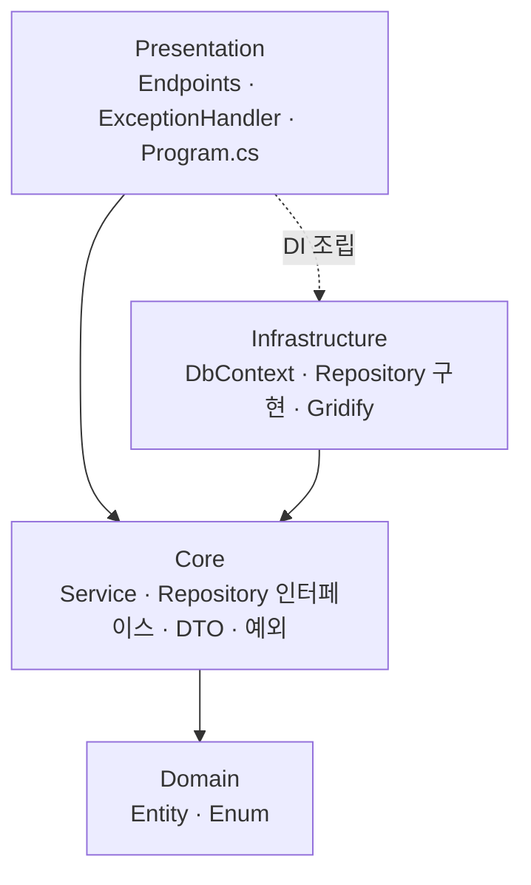

# Clean Architecture 전환 계획

> 상태: **계획** (2026-11-22 작성, 2026-11-24 전체 검토). 아직 적용한 것 없음.
> 범위: 프로젝트 구조·참조 방향을 Clean Architecture 표준으로 바꾸고, 계층 규칙에 어긋나는 로직(Gridify·Serilog 의존, 변환 로직 중복 등)을 정리한다.
> 유지: API 계약(URL, 쿼리스트링, JSON 모양, 상태 코드)과 DB 스키마.
> 범위 밖: DDD 작업(팩토리, private setter, Value Object, Domain Event).

---

## 1. 목표 계층

| 계층 | 프로젝트 | 포함 요소 | 참조 |
|---|---|---|---|
| Presentation | `PersonManager.Presentation` | Endpoints, Endpoint Filter, ExceptionHandler, Program.cs | Core (Infrastructure 는 DI 조립만) |
| Infrastructure | `PersonManager.Infrastructure` | AppDbContext, Configurations, Seeds, Migrations, Repository 구현체, Gridify 매퍼, DB 예외 변환 | Core (Domain 은 전이 참조) |
| Core | `PersonManager.Core` | Service 인터페이스·구현, Repository 인터페이스, DTO, 조회 타입, Mappings, 검증, 로깅 인터셉터, 예외 | Domain |
| Domain | `PersonManager.Domain` | Entity, Enum(`Gender`), Entity 의 도메인 계산(`User.GetAge`) | 없음 |



- **DI 조립만**: Presentation 은 `Program.cs` 에서 `AddInfrastructure(config)` 만 호출한다. Endpoints·ExceptionHandler 등 다른 코드는 Infrastructure 의 타입(EF, `EntityFramework.Exceptions`, Gridify)을 쓰지 않는다.
- **Repository 인터페이스는 Core**: 원전(Robert C. Martin)에서 데이터 접근 인터페이스(Gateway)는 Use Case 계층이 정의하고 바깥 계층이 구현한다. 이 프로젝트의 Core 가 Use Case 계층이다.

### 근거

| 출처 | Repository·데이터 접근 인터페이스 | 가장 안쪽 계층 |
|---|---|---|
| Robert C. Martin, *Clean Architecture* | Use Case 계층 (Gateway) | Entity (기업 비즈니스 규칙) |
| [Jason Taylor 템플릿](https://cleanarchitecture.jasontaylor.dev/docs/architecture) | Application (`IApplicationDbContext`) | Entity, Value Object, Domain Event, Enum |
| [ardalis 템플릿](https://github.com/ardalis/cleanarchitecture) | Core(Domain Model) — DDD Aggregate 전제, 조회는 별도 Query Service | Entity, Aggregate, Value Object, Specification |

이 프로젝트의 Repository 는 filter 조회·페이징·일괄 수정/삭제 위주라 도메인 규칙이 아닌 Use Case 관심사이므로 원전 방식을 따른다. 나중에 DDD Aggregate 규칙이 생기면 쓰기용 Repository 만 Domain 으로 내리는 것을 검토한다.

---

## 2. 현재 구조

프로젝트 7개, N-Layer 구조.

```
Api ──► Services ──► ServiceContracts ──► Entities
 │         ├──► RepositoryContracts ──► Entities
 │         └──► Exceptions
 └──► Repositories ──► RepositoryContracts, Exceptions
```

| 현재 프로젝트 | 내용 | 문제 |
|---|---|---|
| `PersonManager.Entities` | Entity + AppDbContext + Configurations + Seeds + Migrations, EF SqlServer 패키지 | 가장 안쪽 계층이 EF Core 에 의존 |
| `PersonManager.RepositoryContracts` | Repository 인터페이스, `UserUpdate`/`CountryUpdate` | Gridify 패키지(`GridifyQuery`, `Paging<T>`)에 의존 |
| `PersonManager.ServiceContracts` | Service 인터페이스, DTO, `GenderOptions` | Gridify 패키지에 의존 |
| `PersonManager.Services` | Service 구현, Mappings, ValidationHelper, 로깅 인터셉터 | - |
| `PersonManager.Repositories` | Repository 구현, Gridify 매퍼, DI(`AddRepositories`) | - |
| `PersonManager.Exceptions` | `InvalidRequestException` | 파일 1개짜리 프로젝트 |
| `PersonManager.Api` | Minimal API Endpoints, ExceptionHandler, Program.cs | - |

---

## 3. 핵심 결정

| 항목 | 결정 | 이유 |
|---|---|---|
| 프로젝트 위치 | 루트에 그대로 둠 (`src/` 안 만듦) | 기존 관례 유지, 경로 변경 최소화 |
| 폴더 규칙 | `Modules/Identity/{Users,Countries}` 유지 | 기존 관례 유지. 계층 안을 기능별로 나누는 방식은 원전의 Screaming Architecture 와 맞음 |
| namespace 규칙 | `{프로젝트명}.{폴더 경로}` (예: `PersonManager.Domain.Modules.Identity.Users`, `PersonManager.Core.Modules.Identity.Users.Dtos`) | 폴더와 namespace 일치 |
| Repository 인터페이스 위치 | Core (`Core/Modules/Identity/*/I*Repository.cs`) | Clean Architecture 원전 기준 (1장 "근거") |
| Repository 의 Gridify 의존 | Core 에 자체 타입 `ListQuery`, `PagedResult<T>` 를 두고, Infrastructure 에서 `GridifyQuery` 로 변환 | Core 는 Gridify 패키지를 몰라도 됨 |
| `PagedResult<T>` 모양 | `record PagedResult<T>(int Count, IEnumerable<T> Data)` | 기존 응답 `{ count, data }` 와 같음 |
| `InvalidRequestException` | Core 로 옮기고 `PersonManager.Exceptions` 삭제 | Infrastructure·Presentation 모두 Core 를 참조하므로 접근 가능 |
| `UserUpdate`/`CountryUpdate` | Core 의 `Dtos/` 로 (Repository 인터페이스의 매개변수) | Repository 인터페이스와 함께 둠 |
| `Gender` | Domain 의 `Gender` enum 하나로 통합 (`GenderOptions` 삭제). EF 는 `HasConversion<string>()` 로 저장 | Enum 은 Domain 소유(Jason Taylor 템플릿). `ToString()`/`Enum.TryParse` 변환 제거. DB 컬럼(`nvarchar(10)`)·Seed 값 그대로 |
| 나이 계산 | `UserMappings` 의 `DateTime.Now` 계산 → Domain `User.GetAge(DateTime now)`, 현재 시각은 Core 가 `TimeProvider` 로 주입받아 전달 | 도메인 계산은 Domain 에. 시스템 시계 직접 의존 제거(테스트 가능). 계산식(`TotalDays / 365.25`)은 그대로 |
| 로깅 인터셉터 (Castle) | Core. 단 `SerilogTimings` 대신 `ILogger`(Microsoft.Extensions.Logging.Abstractions) + `Stopwatch` 로 재작성 | Core 는 로깅 구현체(Serilog)가 아닌 추상화에만 의존. Serilog 는 Presentation 에서만 설정 |
| EF 예외 매핑 (`UniqueConstraintException` 등) | Infrastructure 가 Core 예외로 변환해 던지고, ExceptionHandler 는 Core 예외만 처리 | Presentation 이 DB·ORM 을 몰라도 됨 (아래 "DB 예외 변환") |
| Migrations | 새로 만들지 않고 `Infrastructure/Data/Migrations/` 로 파일만 옮김 | 이미 DB 에 적용됨. 마이그레이션 Id 가 같으면 `__EFMigrationsHistory` 와 맞음. 영속성 파일을 `Data/` 한 곳에 모음 |
| Seed 경로 | Infrastructure 에도 `Data/Seeds/` 그대로 | `AppDbContext` 의 경로 코드 수정 불필요 |

### DB 예외 변환

`UseExceptionProcessor()` 가 던지는 `EntityFramework.Exceptions` 예외를 Infrastructure 에서 Core 예외로 바꾼다. 응답 상태 코드와 detail 문구는 지금과 같다.

| EF 예외 | Core 예외 | 상태 코드 | detail |
|---|---|---|---|
| `UniqueConstraintException` | `ConflictException` | 409 | The request conflicts with existing data. |
| `ReferenceConstraintException` | `ConflictException` | 409 | The request conflicts with related data. |
| `CannotInsertNullException` | `InvalidRequestException` | 400 | A required value is missing. |
| `MaxLengthExceededException` | `InvalidRequestException` | 400 | A value exceeds the maximum length. |
| `NumericOverflowException` | `InvalidRequestException` | 400 | A numeric value is out of range. |

```csharp
// Core/Common/Exceptions/ConflictException.cs
public sealed class ConflictException : Exception
{
	public ConflictException(string message) : base(message) { }

	public ConflictException(string message, Exception innerException) : base(message, innerException) { }
}

// Infrastructure/Common/Extensions/DbExceptionExtensions.cs
internal static class DbExceptionExtensions
{
	/// <summary>
	/// DB 쓰기 작업을 실행하고, 제약 위반 예외를 Core 예외로 변환 (원본은 InnerException 으로 보존)
	/// </summary>
	public static async Task<T> TranslateDbExceptions<T>(this Task<T> task)
	{
		try
		{
			return await task;
		}
		catch (UniqueConstraintException ex)
		{
			throw new ConflictException("The request conflicts with existing data.", ex);
		}
		// ... 나머지 예외도 위 표대로
	}
}

// Repository 의 쓰기 메서드에서 사용 (SaveChangesAsync, ExecuteUpdateAsync, ExecuteDeleteAsync)
await _db.SaveChangesAsync().TranslateDbExceptions();
```

- `InvalidRequestException` 도 같은 모양으로 `(string message, Exception innerException)` 생성자를 추가해 원본 예외를 로그에서 볼 수 있게 한다.
- `ApiExceptionHandler` 는 `InvalidRequestException` → 400, `ConflictException` → 409, `BadHttpRequestException` 만 처리하고 `EntityFramework.Exceptions.Common` using 을 지운다.

### Entity POCO 규칙

Domain 의 Entity(`User`, `Country`)는 EF Core 를 모르는 POCO 로 유지한다.

| 규칙 | 방법 |
|---|---|
| 매핑은 Fluent API 로만 | 테이블·키·길이·인덱스·FK 는 Infrastructure 의 `IEntityTypeConfiguration<T>` 에만 둔다 |
| Entity 에 attribute 금지 | `[Key]`, `[MaxLength]`, `[Index]`, `[Table]`, `[ForeignKey]` 등을 쓰지 않는다 |
| Lazy Loading 프록시 안 씀 | `UseLazyLoadingProxies()`(`virtual` 강제), `ILazyLoader` 주입을 쓰지 않는다. `Include`/`Load` 로 명시적으로 불러온다 |
| EF 가 쓸 수 있는 생성자 | 매개변수 없는 생성자, 또는 매개변수 이름을 속성과 맞춘 생성자 |
| 빌드로 강제 | `PersonManager.Domain.csproj` 에 `PackageReference` 를 두지 않는다. EF 타입을 쓰면 컴파일 에러 |

- POCO 도 EF 를 모르는 일반 메서드(`User.GetAge`)는 가질 수 있다.
- Seed 는 `JsonSerializer.Deserialize<List<User>>` 로 Entity 를 직접 만든다. public setter 인 지금은 문제없지만, setter 를 private 으로 바꾸면 Seed 전용 record 를 따로 둬야 한다.

### Gender·나이 계산 예시

```csharp
// Domain/Modules/Identity/Users/Gender.cs
public enum Gender { Male, Female, Other }

// Domain/Modules/Identity/Users/User.cs
public Gender? Gender { get; set; }

public double? GetAge(DateTime now) =>
	DateOfBirth is DateTime dateOfBirth ? (now - dateOfBirth).TotalDays / 365.25 : null;

// Infrastructure/Data/Configurations/UserConfiguration.cs
builder.Property(u => u.Gender).HasConversion<string>().HasMaxLength(10);

// Core/Modules/Identity/Users/UsersService.cs
public class UsersService(IUsersRepository _usersRepository, ICountriesRepository _countriesRepository, TimeProvider _timeProvider)
// user.ToResponse(_timeProvider.GetLocalNow().DateTime)
```

- `AppDbContext` 의 Seed 역직렬화에 `JsonStringEnumConverter` 를 넣어야 `"Male"` 문자열이 enum 으로 읽힌다.
- `TimeProvider.System` 은 `AddCore()` 에서 `services.AddSingleton(TimeProvider.System)` 으로 등록한다.

---

## 4. 목표 구조

```
2-Clean-Architecture/
├─ PersonManager.slnx
├─ PersonManager.Domain/                      # PackageReference·ProjectReference 없음
│  └─ Modules/Identity/
│     ├─ Countries/   Country.cs
│     └─ Users/       User.cs, Gender.cs
├─ PersonManager.Core/                        # → Domain
│  ├─ Common/
│  │  ├─ Exceptions/  InvalidRequestException.cs, ConflictException.cs
│  │  ├─ Helpers/     ValidationHelper.cs
│  │  ├─ Logging/     LogExecutionTimeAttribute.cs, ExecutionTimeLoggingInterceptor.cs,
│  │  │               LoggingServiceCollectionExtensions.cs
│  │  └─ Queries/     ListQuery.cs, PagedResult.cs
│  ├─ Modules/Identity/
│  │  ├─ Countries/   ICountriesService.cs, CountriesService.cs, ICountriesRepository.cs,
│  │  │               CountryMappings.cs, Dtos/ (CountryUpdate.cs 포함)
│  │  └─ Users/       IUsersService.cs, UsersService.cs, IUsersRepository.cs,
│  │                  UserMappings.cs, Dtos/ (UserUpdate.cs 포함)
│  └─ DependencyInjection.cs                  # AddCore()
├─ PersonManager.Infrastructure/              # → Core
│  ├─ Data/           AppDbContext.cs, Configurations/, Seeds/, Migrations/
│  ├─ Common/Extensions/ GridifyExtensions.cs   # ListQuery → GridifyQuery 변환 추가
│  │                     DbExceptionExtensions.cs # EF 예외 → Core 예외
│  ├─ Modules/Identity/
│  │  ├─ Countries/   CountriesRepository.cs, CountryGridifyMapper.cs
│  │  └─ Users/       UsersRepository.cs, UserGridifyMapper.cs
│  └─ DependencyInjection.cs                  # AddInfrastructure(IConfiguration)
└─ PersonManager.Presentation/                # → Core, Infrastructure(DI 조립만) (PersonManager.Api 에서 이름 변경)
   ├─ Common/ExceptionHandlers/ApiExceptionHandler.cs
   ├─ Endpoints/  (namespace·using 만 수정)
   └─ Program.cs
```

### 패키지 배치

| 프로젝트 | 패키지 |
|---|---|
| Domain | 없음 |
| Core | Castle.Core, Castle.Core.AsyncInterceptor, Microsoft.Extensions.DependencyInjection.Abstractions, Microsoft.Extensions.Logging.Abstractions (SerilogTimings 제거) |
| Infrastructure | Microsoft.EntityFrameworkCore.SqlServer, EFCore.NamingConventions, EntityFrameworkCore.Exceptions.SqlServer, Gridify.EntityFramework, System.Security.Cryptography.Pkcs, Microsoft.Extensions.DependencyInjection.Abstractions |
| Presentation | 기존 그대로 (OpenApi, EF Design, Serilog.*, SwaggerUI) |

### Core 조회 타입·Repository 인터페이스 예시

```csharp
// Core/Common/Queries/ListQuery.cs
public sealed record ListQuery(string? Filter, string? OrderBy, int Page = 1, int PageSize = 20);

// Core/Common/Queries/PagedResult.cs
public sealed record PagedResult<T>(int Count, IEnumerable<T> Data);

// Core/Modules/Identity/Users/IUsersRepository.cs
public interface IUsersRepository
{
	Task<List<User>> CreateUsers(List<User> users);
	Task<PagedResult<User>> GetUsers(ListQuery query);
	Task<int> UpdateUsers(string filter, UserUpdate values);
	Task<int> DeleteUsers(string filter);
}

// Infrastructure/Common/Extensions/GridifyExtensions.cs
public static GridifyQuery ToGridifyQuery(this ListQuery q) =>
	new() { Filter = q.Filter, OrderBy = q.OrderBy, Page = q.Page, PageSize = q.PageSize };
```

Presentation 의 `GridifyQueryParameters.ToGridifyQuery()` 는 `ListQueryParameters.ToListQuery()` 로 바꾼다(page, pageSize 기본값 1, 20 유지).

---

## 5. 파일 매핑

| 현재 | 목표 |
|---|---|
| `Entities/Modules/Identity/*/{User,Country}.cs` | `Domain/Modules/Identity/*/` |
| `RepositoryContracts/Modules/Identity/*/I*Repository.cs` | `Core/Modules/Identity/*/` |
| `RepositoryContracts/Modules/Identity/*/Dtos/*Update.cs` | `Core/Modules/Identity/*/Dtos/` |
| `Entities/Data/` (AppDbContext, Configurations, Seeds) | `Infrastructure/Data/` |
| `Entities/Migrations/` | `Infrastructure/Data/Migrations/` |
| `ServiceContracts/Modules/Identity/Users/Enums/GenderOptions.cs` | `Domain/Modules/Identity/Users/Gender.cs` (이름 변경) |
| `Repositories/**` | `Infrastructure/**` |
| `ServiceContracts/Modules/**` | `Core/Modules/**` |
| `Services/Modules/**` | `Core/Modules/**` |
| `Services/Common/{Helpers,Logging}/` | `Core/Common/{Helpers,Logging}/` |
| `Exceptions/InvalidRequestException.cs` | `Core/Common/Exceptions/` |
| `Services/DependencyInjection.cs` (`AddServices`) | `Core/DependencyInjection.cs` (`AddCore`) |
| `Repositories/DependencyInjection.cs` (`AddRepositories`) | `Infrastructure/DependencyInjection.cs` (`AddInfrastructure`) |
| `PersonManager.Api/**` | `PersonManager.Presentation/**` |

### 삭제할 파일·구조

| 대상 | 이유 |
|---|---|
| 프로젝트 6개: `PersonManager.Entities`, `RepositoryContracts`, `Repositories`, `ServiceContracts`, `Services`, `Exceptions` (폴더 + slnx 항목) | 내용을 4개 프로젝트로 옮긴 뒤 빈 껍데기 |
| `ICountriesRepository.ExistsCountryById` (+ 구현) | `ExistsCountriesByIds([id])` 와 기능이 같음. `UsersService.UpdateUsers` 도 `ExistsCountriesByIds` 를 쓰도록 통일 |
| `GridifyExtensions.ApplyBulkFiltering` 의 빈 filter 검사 (`"Filter is required for bulk operations"`) | `ValidationHelper.FilterValidation` 이 서비스에서 먼저 막으므로 도달하지 않는 중복 코드. "빈 filter 금지" 는 Use Case 규칙이라 Core 에만 둔다 |
| `UserResponse.ToString()` override | 사용하는 곳 없음 |
| `Paging<T>`(Gridify) 사용처 전부 | `PagedResult<T>` 로 대체 |
| `ApiExceptionHandler` 의 EF 예외 분기 5개, `using EntityFramework.Exceptions.Common` | Infrastructure 의 DB 예외 변환으로 대체 |
| `Core/Modules/Identity/Users/Enums/` 폴더 | `Gender` 가 Domain 으로 이동 |
| `UserMappings` 의 `Gender?.ToString()`, `Enum.TryParse<GenderOptions>` | Entity·DTO 가 같은 enum 을 써서 변환 불필요 |
| `UserMappings.ToResponse` 의 `DateTime.Now` 나이 계산 | `User.GetAge(now)` 로 대체 |
| `SerilogTimings` 패키지와 `Operation.Begin` 사용 코드 | `ILogger` + `Stopwatch` 로 대체 |

### 수정할 파일

| 파일 (목표 위치) | 수정 내용 |
|---|---|
| `Core/Common/Logging/ExecutionTimeLoggingInterceptor.cs` | `IGridifyFiltering` 대신 `ListQuery` 로 filter 를 기록 (`ListQuery q => q.Filter`). `SerilogTimings` 대신 `ILogger` + `Stopwatch` 로 completed/abandoned 와 소요 시간 기록. 인터셉터가 `ILoggerFactory` 를 받도록 `AddLoggedScoped` 도 수정 |
| `Domain/Modules/Identity/Users/User.cs` | `Gender` 를 `Gender?` enum 으로, `GetAge(DateTime now)` 추가 |
| `Core/Modules/Identity/Users/Dtos/*` | `GenderOptions` → `Gender` (`[EnumDataType(typeof(Gender))]`) |
| `Core/Modules/Identity/Users/Dtos/UserUpdate.cs` | `string? Gender` → `Gender? Gender` |
| `Core/Modules/Identity/Users/UserMappings.cs` | Gender 변환 제거, `ToResponse(this User user, DateTime now)` 로 `GetAge` 호출 |
| `Core/Modules/Identity/Users/UsersService.cs` | `TimeProvider` 주입 |
| `Infrastructure/Data/Configurations/UserConfiguration.cs` | `HasConversion<string>()` 추가 |
| `Infrastructure/Data/AppDbContext.cs` | Seed 역직렬화에 `JsonStringEnumConverter` 추가 |
| `Core/Common/Exceptions/InvalidRequestException.cs` | `(string message, Exception inner)` 생성자 추가 |
| `Core/Common/Exceptions/ConflictException.cs` | 새로 만듦 |
| `Core/Common/Queries/ListQuery.cs`, `PagedResult.cs` | 새로 만듦 |
| `Core/Modules/Identity/*/I*Service.cs`, `*Service.cs` | `GridifyQuery`/`Paging<T>` → `ListQuery`/`PagedResult<T>` |
| `Core/Modules/Identity/*/I*Repository.cs` | 같은 교체 + `ExistsCountryById` 삭제 |
| `Core/Modules/Identity/Users/UsersService.cs` | `ExistsCountryById(id)` → `ExistsCountriesByIds([id])` |
| `Infrastructure/Common/Extensions/GridifyExtensions.cs` | `ListQuery.ToGridifyQuery()`, `Paging<T>.ToPagedResult()` 추가, 빈 filter 검사 삭제 |
| `Infrastructure/Common/Extensions/DbExceptionExtensions.cs` | 새로 만듦 (3장 "DB 예외 변환") |
| `Infrastructure/Modules/Identity/*/*Repository.cs` | 조회 타입 변환, 쓰기 메서드에 `TranslateDbExceptions()` |
| `Infrastructure/Data/AppDbContext.cs`, `Configurations/*`, `Migrations/*` | namespace·using 만 |
| `Infrastructure/DependencyInjection.cs` | `AddRepositories` → `AddInfrastructure` |
| `Core/DependencyInjection.cs` | `AddServices` → `AddCore` |
| `Presentation/Endpoints/Common/Parameters/GridifyQueryParameters.cs` | `ListQueryParameters` 로 이름 변경, `ToListQuery()` 반환. Presentation 에서 Gridify 이름 제거 |
| `Presentation/Endpoints/Modules/Identity/*/*Endpoints.cs` | 반환 타입 `Paging<T>` → `PagedResult<T>`, `using Gridify` 삭제 |
| `Presentation/Common/ExceptionHandlers/ApiExceptionHandler.cs` | Core 예외만 처리 (`ConflictException` → 409 추가) |
| `Presentation/Program.cs` | `AddInfrastructure(config).AddCore()` |
| `Presentation/PersonManager.Presentation.csproj` | Api csproj 이름 변경, 참조를 Core·Infrastructure 로 |
| `PersonManager.slnx` | 프로젝트 목록을 4개로 |
| `.vscode/tasks.json` | `--project`·`--startup-project` 경로 |
| `.claude/rules/api-query.md` | 매퍼 경로(`PersonManager.Infrastructure/...`), `ValidationHelper`·`GridifyExtensions` 위치 설명 |
| `.gitignore` (상위) | `Database/` 추가 (SQL Server 데이터 파일, docker volume). 폴더 자체는 DB 데이터라 삭제하지 않는다 |

### 유지하는 것 (검토했지만 바꾸지 않음)

| 대상 | 이유 |
|---|---|
| `ValidationHelper.ModelValidation` 과 `AddValidation()` 의 중복 검증 | Core 는 Presentation 을 믿지 않고 스스로 입력을 검증해야 한다(다른 진입점이 생겨도 동작). 응답 모양도 바뀌지 않음 |
| `UserUpdate`/`CountryUpdate` (Request DTO 와 비슷함) | Repository 가 검증 attribute·중첩 DTO 가 붙은 Request 를 몰라도 되도록 분리 유지 |
| `UserCreateRequest.Country` 가 `CountryResponse` 타입 | 바꾸면 요청 JSON 모양이 바뀜 (API 계약 유지) |
| `ListQuery.Filter`·bulk 수정/삭제의 filter 가 Gridify 문법 문자열 | **타협.** Core 가 Gridify 패키지는 모르지만 문자열 문법은 Gridify 를 따른다. API 가 이 문법을 그대로 받으므로 Specification 으로 바꿔도 문자열을 다시 해석하는 층만 늘어남 |
| Gridify 매퍼의 `GenerateMappings` (Entity 속성 이름 = API 필터 필드) | **타협.** Entity 속성 이름을 바꾸면 API 필터 필드도 바뀐다. 필드를 `AddMap` 으로 직접 등록하면 끊기지만 필드 추가 때마다 수동 등록 필요 |
| 이메일·국가 이름 중복을 DB 유니크 인덱스로, Country 삭제 시 `SetNull` 을 DB FK 로 처리 | 동시 요청에도 안전한 표준 방식. 위반은 Core 예외로 변환되므로 계층 규칙에 어긋나지 않음 |
| Service 인터페이스(`IUsersService` 등) | 원전의 Input Port. 로깅 프록시(Castle)도 인터페이스가 필요 |
| 계층 이름 `Core` (템플릿은 보통 `Application`) | 처음 정한 이름 유지. 역할은 원전의 Use Case 계층과 같음 |

---

## 6. 작업 단계

2~5단계는 서로 참조가 얽혀 있어 중간에는 빌드가 깨진다. **한 브랜치에서 2~5단계를 이어서 진행하고, 5단계 끝에 `dotnet build PersonManager.slnx` 가 통과해야** 6단계로 넘어간다.

0. **기준 커밋**: 현재 `2-Clean-Architecture/` 폴더 전체가 git 에 추적되지 않은 상태(`??`)라 `git mv` 가 실패한다. 먼저 현재 코드를 그대로 커밋해 두고 시작한다(이력 보존 + 되돌릴 기준점). `Database/` 는 커밋 전에 `.gitignore` 에 추가.
1. **프로젝트 생성**: Domain, Core, Infrastructure csproj 를 만들고 `ProjectReference` 는 1장 표, 패키지는 4장 표대로 설정, `PersonManager.slnx` 에 추가.
2. **Domain**: `git mv` 로 Entity(`User`, `Country`)와 `GenderOptions.cs`(→ `Gender.cs`)를 옮김. `User.Gender` 를 enum 으로, `GetAge` 추가.
3. **Core**: `git mv` 로 ServiceContracts·Services·Exceptions·RepositoryContracts 내용을 옮김. `ListQuery`, `PagedResult<T>` 추가. Service·Repository 인터페이스와 Service 구현의 `GridifyQuery`/`Paging<T>` 를 `ListQuery`/`PagedResult<T>` 로 교체. `ConflictException` 추가. 로깅 인터셉터의 `IGridifyFiltering` 제거·`ILogger` 로 재작성, `ExistsCountryById` 통합. Gender 변환 제거, `TimeProvider` 주입. `AddCore()` 작성.
4. **Infrastructure**: `git mv` 로 Entities/Data, Migrations, Repositories 내용을 옮김. Repository 에서 `ListQuery → GridifyQuery`, `Paging<T> → PagedResult<T>` 변환. `DbExceptionExtensions` 를 만들고 쓰기 메서드에 `TranslateDbExceptions()` 적용. `ApplyBulkFiltering` 의 빈 filter 검사 삭제. `UserConfiguration` 에 `HasConversion<string>()`, Seed 역직렬화에 `JsonStringEnumConverter`. Seeds 의 `CopyToOutputDirectory` 옮김. `AddInfrastructure()` 작성.
5. **Presentation**: `git mv PersonManager.Api PersonManager.Presentation` 으로 폴더·csproj 이름 변경, slnx 경로 수정. namespace `PersonManager.Api.*` → `PersonManager.Presentation.*`. csproj 참조를 Core, Infrastructure 로 교체. `Program.cs` 의 `AddRepositories().AddServices()` → `AddInfrastructure(config).AddCore()`. Endpoints·ExceptionHandler 의 using 수정, `GridifyQueryParameters` → `ListQueryParameters.ToListQuery()`. `UserResponse.ToString()` 삭제. `ApiExceptionHandler` 에서 EF 예외 분기를 지우고 `ConflictException` → 409 추가.
6. **정리**: 기존 프로젝트 6개(Entities, RepositoryContracts, Repositories, ServiceContracts, Services, Exceptions) 폴더와 slnx 항목 삭제.
7. **경로 수정**
   - `.vscode/tasks.json`: `--project PersonManager.Entities --startup-project PersonManager.Api` → `--project PersonManager.Infrastructure --startup-project PersonManager.Presentation`
   - `.claude/rules/api-query.md`: 매퍼 경로 `PersonManager.Repositories/...` → `PersonManager.Infrastructure/...`, `ValidationHelper`·`GridifyExtensions` 위치 설명

---

## 7. 주의사항

- **Migration namespace**: `.Designer.cs`·`AppDbContextModelSnapshot.cs` 의 `[DbContext(typeof(AppDbContext))]` using 과, 스냅샷 안의 엔티티 이름 문자열(`"PersonManager.Entities.Modules.Identity.Users.User"`)을 새 namespace 로 바꾼다. 테이블·컬럼은 그대로라 새 마이그레이션은 필요 없다.
- **모델 변경 확인**: 옮긴 뒤 아래 명령이 변경 없음을 보고해야 한다.
  ```bash
  dotnet ef migrations has-pending-model-changes --project PersonManager.Infrastructure --startup-project PersonManager.Presentation
  ```
- **`ApplyConfigurationsFromAssembly`**: `typeof(AppDbContext).Assembly` 기준이므로 Configurations 는 반드시 AppDbContext 와 같은 Infrastructure 프로젝트에 둔다.
- **로깅 인터셉터 프록시**: `AddLoggedScoped` 는 인터페이스 프록시라서 Service 인터페이스와 구현이 같은 Core 에 있어도 동작은 같다. `[LogExecutionTime(nameof(query))]` 의 매개변수 이름은 유지.
- **ExceptionHandler**: EF 예외 대신 Core 예외로 분기하지만, 응답 상태 코드와 detail 문구는 그대로.
- **Gender enum 전환**: `HasConversion<string>()` + `HasMaxLength(10)` 이면 컬럼은 그대로 `nvarchar(10)` 이고 Seed 값도 `"Male"`/`"Female"`/`"Other"` 그대로라 `has-pending-model-changes` 가 변경 없음이어야 한다. 변경이 나오면 변환 설정을 다시 확인한다.
- **로그 형식 변경**: `SerilogTimings` 의 메시지(`... completed in N ms`)와 같은 템플릿·속성 이름(`Elapsed`, `Outcome`)을 `ILogger` 로 재현해 로그 DB(`logs` 테이블) 조회가 깨지지 않게 한다.
- **쓰기 메서드 누락 주의**: `TranslateDbExceptions()` 를 빠뜨린 쓰기 메서드는 제약 위반 시 409 대신 500 이 된다. `SaveChangesAsync`·`ExecuteUpdateAsync`·`ExecuteDeleteAsync` 호출부를 모두 확인한다.

---

## 8. 검증 체크리스트

- [ ] `dotnet build PersonManager.slnx` 경고·에러 없음
- [ ] `PersonManager.Domain.csproj` 에 `PackageReference`·`ProjectReference` 없음
- [ ] Domain Entity 에 attribute·`virtual` 내비게이션·EF 타입 없음 (POCO)
- [ ] Domain 에 인터페이스(Repository 등) 없음, Repository 인터페이스는 Core 에만 있음
- [ ] `PersonManager.Core.csproj` 는 Domain 만 참조, EF·Gridify·Serilog 패키지 없음
- [ ] `PersonManager.Infrastructure.csproj` 는 Core 만 참조
- [ ] Presentation 에서 Infrastructure 네임스페이스 using 은 `Program.cs` 에만 있음
- [ ] `grep -r "Gridify" PersonManager.Core PersonManager.Domain PersonManager.Presentation` 결과 없음 (bin·obj 제외)
- [ ] `has-pending-model-changes` 가 변경 없음 보고
- [ ] `docker compose up -d` 후 `dotnet ef database update` 정상
- [ ] `dotnet run --project PersonManager.Presentation` 후 기존과 동작 같음
  - [ ] `GET /api/users?filter=country.name=Korea&orderBy=name&page=1&pageSize=5` → `{ count, data }`
  - [ ] `GET /api/countries`
  - [ ] 매핑 안 된 필드로 filter → 400
  - [ ] `POST /api/users` 에 잘못된 값 → 400, 중복 이메일 → 409
  - [ ] 빈 filter 로 `PATCH`/`DELETE` → 400
  - [ ] `GET /api/users?filter=gender=Male` 정상, 응답의 `gender` 가 문자열(`"Male"`), `age` 값이 기존과 같음
  - [ ] 서비스 실행 시간 로그(completed/abandoned)가 콘솔·파일·DB 에 기존과 같은 속성으로 남음
